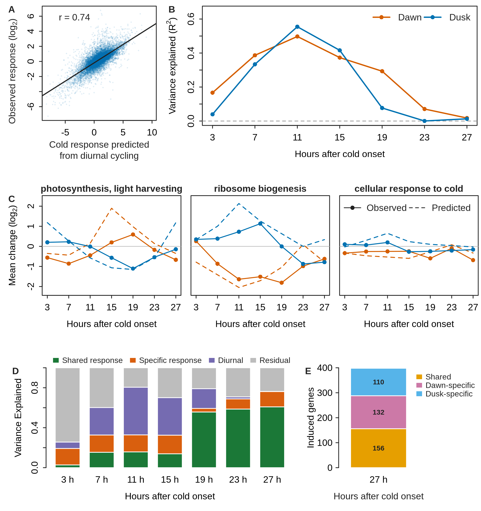

# Figure 2 — A frozen diurnal clock explains part of the sorghum cold response

This folder holds everything used to make Figure 2: the code, the input data, the exact
numbers plotted in each panel, and the finished figure.

| File or folder | What it is |
|---|---|
| `Figure2.png` | Final figure, 1950 × 2070 px (6.5 × 6.9 in, 300 dpi) |
| `Figure2.svg` | Final figure, editable vector version |
| `panels/Figure2A.png` … `Figure2E.png` | Each panel on its own |
| `results/panel_A/` … `panel_E/` | The numbers plotted in each panel (see *Results, panel by panel*) |
| `results/run_summary.txt` | Gene universe size and R version of the last run |
| `code/` | All code: the figure script, its two helper scripts, and the four upstream steps that make its inputs |
| `data/` | All input data, with `SHA256SUMS.txt` |
| `requirements.txt` | Software versions |

## The idea

If cold stops the circadian clock, a cold-treated leaf stays at the diurnal state it had
when cold began. Its time-matched control keeps cycling. The expected cold response of each
gene is then its diurnal expression at cold onset minus its diurnal expression at the
control's collection time. This "fixed onset-hold" prediction comes entirely from an
independent diurnal time series, with no fitting to the cold data.

- **Cold onset:** dawn at ZT1, dusk at ZT13. Dusk cold began 12 h after dawn cold, so a
  dusk sample *h* hours after onset was collected at wall-clock T(*h* + 12).
- **Genes:** 15,130. These have a mean TPM ≥ 3 in the external diurnal series and were
  tested by DESeq2.
- **Response:** log2(TPM + 0.1) of each cold library minus its time-matched control in the
  same growth trial. There are three growth trials.

## Results, panel by panel

### A — Predicted vs observed response, 11 h after dusk onset

Each point is one gene. The x axis is the fixed onset-hold prediction and the y axis is the
observed response (log2 cold/control, mean of three trials). The line is the least-squares
fit.

| | |
|---|---|
| Genes | 15,130 |
| Pearson r | 0.745 |
| Fitted line | observed = −0.185 + 0.487 × predicted |

Files: `panelA_gene_points.csv` (`gene_id, predicted_response_log2, observed_response_log2`)
and `panelA_correlation_and_line.csv`.

### B — Variance explained by the prediction over time

R² is the squared Pearson correlation between the prediction and the observed response
across all genes, for each treatment and duration.

| Hours after onset | 3 | 7 | 11 | 15 | 19 | 23 | 27 |
|---|---|---|---|---|---|---|---|
| Dawn R² | 0.167 | 0.387 | 0.497 | 0.373 | 0.293 | 0.071 | 0.018 |
| Dusk R² | 0.039 | 0.334 | 0.555 | 0.416 | 0.077 | 0.000 | 0.013 |

The prediction explains up to half of the response at 11 h and almost none of it by
23–27 h.

Files:
- `panelB_variance_explained.csv`: `treatment, hours_after_onset, genes, pearson_r,
  variance_aligned_r_squared`.
- `panelB_channel_agreement_not_plotted.csv`: R² computed separately for the Dawn+Dusk mean
  and the Dawn−Dusk contrast. It shows the prediction carries information about the
  contrast, not the shared response, which is why panel D applies it only to the contrast.

### C — Observed and predicted change of three GO terms

Mean observed change (solid lines with points) and mean prediction (dashed lines) of all
genes in each GO term, for Dawn (orange) and Dusk (blue).

| GO term | ID | Genes in the universe |
|---|---|---|
| photosynthesis, light harvesting | GO:0009765 | 35 |
| ribosome biogenesis | GO:0042254 | 455 |
| cellular response to cold | GO:0070417 | 29 |

File: `panelC_go_term_mean_change.csv`, 42 rows (3 terms × 2 treatments × 7 times):
`go_id, go_name, treatment, hours_after_onset, genes, mean_observed_change,
mean_fixed_prediction`.

### D — Held-out variance partition

Each bar is how much of the response in a held-out growth trial is predicted. Models are
fitted on two trials and scored on the third, for each of the three choices, with squared
errors summed over trials, genes and both onsets. Models are added in turn:

1. **Diurnal:** the fixed prediction applied to the Dawn−Dusk contrast, with one scale
   fitted on the training trials.
2. **Shared response:** plus each gene's mean residual response, common to Dawn and Dusk.
3. **Specific response:** plus each gene's half Dawn−Dusk residual difference.

Each segment is the drop in squared error from adding that term, as a fraction of the
squared error of predicting no response. **Residual** is what the full model leaves.

| Hours after onset | 3 | 7 | 11 | 15 | 19 | 23 | 27 |
|---|---|---|---|---|---|---|---|
| Diurnal | 0.064 | 0.275 | 0.477 | 0.376 | 0.197 | 0.020 | 0.001 |
| Shared response | 0.028 | 0.154 | 0.158 | 0.139 | 0.557 | 0.587 | 0.609 |
| Specific response | 0.165 | 0.173 | 0.170 | 0.187 | 0.036 | 0.102 | 0.153 |
| Residual | 0.744 | 0.398 | 0.195 | 0.299 | 0.209 | 0.291 | 0.237 |

The diurnal term dominates at 7–15 h. The shared cold response takes over from 19 h.

Files:
- `panelD_variance_partition.csv`: one row per time; the four columns sum to 1.
- `panelD_held_out_fold_sums_of_squares.csv`: the squared errors of each held-out trial
  behind the partition, and the fitted diurnal scale.

### E — Induced genes at 27 h

Genes in each residual induction category 27 h after onset, after the external diurnal
component is removed. Categories come from a joint limma model of the diurnal-adjusted
responses (`code/generate_diurnal_adjusted_response_table.R`).

| Category | Genes |
|---|---|
| Shared | 156 |
| Dawn-specific | 132 |
| Dusk-specific | 110 |

File: `panelE_induced_gene_counts.csv`. It also holds the 3-h counts (0 shared, 53
Dawn-specific, 34 Dusk-specific), which are not plotted (`plotted = FALSE`).

## Code

| Script | Makes | Reads |
|---|---|---|
| `code/plot_figure2.R` | The figure, the panels, `results/` | Everything below, through the two helpers |
| `code/analysis_universe.R` | Helper: gene universe, log2 expression, sample lookup, fixed onset-hold prediction | TPM, metadata, DESeq2 table, external reference |
| `code/component_aligned_diurnal_model.R` | Helper: fits the diurnal scale to the Dawn−Dusk contrast (panel D) | — |
| `code/deseq2_timepoint_contrasts.R` | `data/generatable/deseq2_timepoint_contrasts.csv.gz` | read counts, metadata |
| `code/build_external_diurnal_reference.R` | `data/generatable/external_diurnal_reference.tsv.gz` | external diurnal TPM |
| `code/generate_diurnal_adjusted_response_table.R` | `data/generatable/diurnal_adjusted_response_categories.csv.gz` | TPM, metadata, DESeq2 table, external reference |
| `code/prepare_go_tested_sets.py` (+ `_datasets.py`, `_tables.py`) | `data/generatable/go_tested_sets.tsv.gz` | GO associations, GO ontology, DESeq2 table |
| `code/run_all.sh` | Runs the steps in order | |

What the upstream steps do:

- **DESeq2:** one model, `~ growth_trial_date + group`, on 72 libraries. There are 14
  contrasts, each cold group against its time-matched control. DEG = BH-adjusted P < 0.05
  and |log2FC| ≥ 1. The DESeq2 table is also how the gene universe is limited to tested
  genes.
- **External diurnal reference:** the independent 24-sample BTx623 diurnal series, sampled
  every 3 h for three days. For every detected gene, it runs JTK_CYCLE (MetaCycle) and
  builds an eight-phase waveform: log2 TPM with day offsets removed, averaged at each phase.
  Rhythmicity is descriptive only and does not select genes.
- **Response categories:** the external diurnal waveform is removed first. A single joint
  limma model then separates collection phase in the cold from the 27-h onset-history term,
  and tests shared, Dawn-specific and Dusk-specific induction as contrasts.
- **GO gene sets:** GO terms are propagated through `is_a` and `part_of`, kept if they have
  20–3,000 tested genes, and redundant ancestors are pruned.

## Data (`data/`)

| File | Size | Contents |
|---|---|---|
| `provided/sorghum_cold_timecourse_sample_metadata.csv` | 5 KB | One row per library: sample name, time, treatment (CONT, DAWN, DUSK), replicate, collection time |
| `provided/sorghum_v5.1_go_associations.tsv.gz` | 0.6 MB | GO annotations of sorghum v5.1 genes |
| `externalsourcerequired/kallisto_tpms.csv.gz` | 3.9 MB | kallisto TPM, 32,160 genes × 75 libraries |
| `externalsourcerequired/kallisto_counts_filtered.csv.gz` | 2.7 MB | kallisto read counts, 22,589 genes × 75 libraries (DESeq2 input) |
| `externalsourcerequired/sorghum_2020_diurnal_tpms.csv.gz` | 1.3 MB | Independent BTx623 diurnal series, 24 samples |
| `externalsourcerequired/go_2026-06-19.obo` | 32 MB | Gene Ontology, release 2026-06-19 |
| `generatable/deseq2_timepoint_contrasts.csv.gz` | 21 MB | DESeq2 results, 22,588 genes × 14 contrasts |
| `generatable/external_diurnal_reference.tsv.gz` | 2.4 MB | JTK results and eight-phase waveform of each gene |
| `generatable/diurnal_adjusted_response_categories.csv.gz` | 5.5 MB | Response category, q values and adjusted responses of each gene at 3 and 27 h |
| `generatable/go_tested_sets.tsv.gz` | 1.3 MB | Genes in each tested GO term |

`generatable/` files are made by the upstream steps and committed so the figure can be
redrawn without rerunning them. Check all files with
`cd data && sha256sum -c SHA256SUMS.txt`.

## Rebuilding

    bash code/run_all.sh          # redraw from the committed data, about 15 s
    bash code/run_all.sh --all    # rerun every upstream step first (overwrites data/generatable/)

Works from any directory, including paths with spaces.

**Checked:**
- `code/plot_figure2.R` reproduces `Figure2.png` pixel for pixel.
- `prepare_go_tested_sets.py` reproduces `go_tested_sets.tsv.gz` exactly (2,402 terms).
- The DESeq2 step, rerun from the same counts, gives the same Up / Not DEG / Down call for
  all 316,232 gene × contrast rows; the numbers differ by ≤ 1e-6.

**Not rerun here:** `build_external_diurnal_reference.R` and
`generate_diurnal_adjusted_response_table.R`. They pin MetaCycle 1.2.1 and limma 3.68.4
(R 4.6 / Bioconductor 3.22) and stop with other versions. Their committed outputs are the
ones the figure uses.

## Colours

- Dawn: orange, Dusk: blue (A–C). Panel A shows the dusk onset.
- C: solid with points = observed, dashed = predicted.
- D: green = shared response, orange = specific response, purple = diurnal, gray = residual.
- E: gold = shared, pink = Dawn-specific, light blue = Dusk-specific. These colours are
  not used elsewhere in the figure, so the categories aren't read as onsets or model terms.
