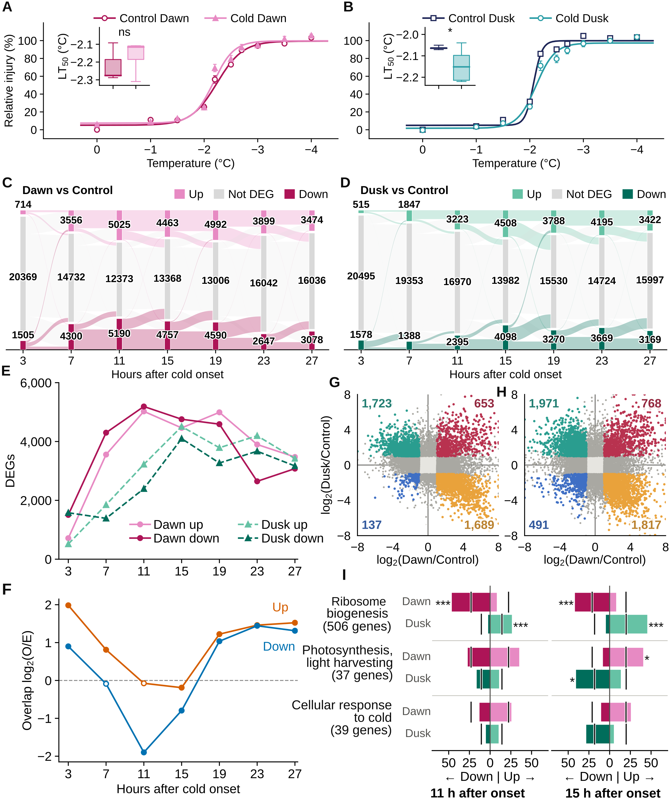

# Figure 1 — Freezing tolerance and transcriptome responses to dawn and dusk cold onset in sorghum

This folder holds everything used to make Figure 1: the code, the input data, the exact
data plotted in each panel, and the finished figure.

| File | What it is |
|---|---|
| `Figure1.png` | Final figure, 2600 × 3100 px (6.5 × 7.75 in, 400 dpi) |
| `Figure1.svg` | Final figure, editable vector version (text kept as text, font Arial) |
| `Figure1_legend.md` | Full figure legend |
| `panels/` | Each panel as a separate PNG and SVG |
| `code/` | Python scripts that build the panel data and draw the panels |
| `code/R/deseq2_timepoint_contrasts.R` | R script for the DESeq2 differential-expression analysis that makes the DEG table |
| `data/source/` | Input tables, with `SHA256SUMS.txt` |
| `data/panel_*/` | The exact numbers plotted in each panel |
| `earlier_versions/Figure1_handedited_scatter_IJ.svg` | Hand-arranged layout that the final assembly step builds on (see *How the final figure is assembled*) |
| `requirements.txt` | Python package versions |

## Panels

| Panel | Shows | Code | Plotted data |
|---|---|---|---|
| A | Dawn onset: control vs cold day 1, relative freezing injury and LT50 inset | `panel_A_B_freezing.py` | `data/panel_A/` |
| B | Dusk onset: control vs cold day 1, relative freezing injury and LT50 inset | `panel_A_B_freezing.py` | `data/panel_B/` |
| C | Dawn vs Control: transitions of all 22,588 tested genes between Up, Not DEG and Down | `panel_C_D_alluvial.py` | `data/panel_C/` |
| D | Dusk vs Control: same, for dusk onset | `panel_C_D_alluvial.py` | `data/panel_D/` |
| E | Numbers of up- and downregulated DEGs at matched durations of cold | `panel_E_deg_counts.py` | `data/panel_E/` |
| F | Expression-controlled overlap of same-direction Dawn and Dusk DEGs, log2(observed/expected) | `panel_F_overlap.py` | `data/panel_F/` |
| G | log2(Dawn/Control) vs log2(Dusk/Control) for every tested gene, 11 h after onset | `panel_G_H_gene_scatter.py` | `data/panel_G/` |
| H | Same, 15 h after onset | `panel_G_H_gene_scatter.py` | `data/panel_H/` |
| I | Percent of genes in three GO terms that are up or down DEGs, 11 h (left) and 15 h (right) after onset | `panel_I_J_bars.py` | `data/panel_I_J/` |

Panel I contains both time points as two side-by-side bar charts. The code and data call
these I (11 h) and J (15 h).

## Input data (`data/source/`)

| File | Used for | Contents |
|---|---|---|
| `kallisto_counts_filtered.csv.gz` | DESeq2 | kallisto gene-level read counts, 22,589 genes × 75 libraries (`GeneID` + one column per sample; 72 are used); input to `code/R/deseq2_timepoint_contrasts.R` |
| `sorghum_cold_timecourse_sample_metadata.csv` | DESeq2 | One row per library: sample name, species, time, treatment (CONT, DAWN, DUSK), replicate, collection time; columns in the same order as the count table |
| `Ion_leakage_relative_injury_summary_v2.xlsx` | A, B | Ion-leakage measurements and relative injury for every sample. Panels A and B use the `D1 Sorg dawn ctl v cold1` and `D1 Sorg dusk ctl v cold1` tabs (sorghum, cold day 1). |
| `deseq2_timepoint_contrasts.csv.gz` | C, D, E (check), G, H | DESeq2 result of every tested gene for each cold-vs-control contrast: `gene_id, treatment, time_h, contrast, base_mean, log2_fold_change, fold_change, lfc_se, wald_statistic, p_value, adjusted_p_value, de_status`. DEG = \|log2FC\| ≥ 1 and BH-adjusted P < 0.05. |
| `dawndusk_overlap_summary.csv` | E, F | DEG counts and observed/expected overlap of Dawn and Dusk DEGs at each matched duration (whole-transcriptome and expression-dodecile expectations). |
| `go_enrichment_timepoint_contrasts.tsv.gz` | I | GO enrichment (Fisher's exact test, GOATOOLS, tested-gene background, BH within each contrast and direction) of the DEGs of each contrast. |

Check the files with `cd data/source && sha256sum -c SHA256SUMS.txt`.

## Differential expression (DESeq2)

`code/R/deseq2_timepoint_contrasts.R` makes `data/source/deseq2_timepoint_contrasts.csv.gz`
from the count table and sample metadata.

- **Libraries:** 72, three per time × treatment group, one from each of three growth
  trials. The groups are Dawn at T3–T27, Dusk at T15–T39, and the controls at those times.
- **Model:** one DESeq2 fit, `~ growth_trial_date + group`. Growth trial is a blocking
  factor, and each time × treatment combination is one level of `group`.
- **Contrasts:** 14, each cold group against the control at the same time point
  (Dawn T3–T27, Dusk T15–T39).
- **DEG:** BH-adjusted P < 0.05 and |log2 fold change| ≥ 1. Independent filtering is off.
- **Genes:** 22,588 tested. One gene that does not converge, Sobic.004G220500.1, is
  excluded, and the script stops if any other gene fails to converge.

Run it with:

    Rscript code/R/deseq2_timepoint_contrasts.R

It takes about 1–2 minutes and needs R ≥ 4.3 with DESeq2 (built with R 4.3.1 and DESeq2
1.42.1). The output goes to `data/deseq2_output/`, not over the committed table. A rerun
gives the same Up / Not DEG / Down call for all 316,232 gene × contrast rows. The numbers
differ from the committed table only by floating-point noise (≤ 1e-7 in log2 fold change,
≤ 1e-6 in adjusted P).

Time: "Hours after cold onset" is the same for both treatments. Dusk cold began 12 h after
dawn cold, so the dusk sample at *h* hours after onset was collected at experiment time
*h* + 12 (for example, dusk 3 h = T15).

## Plotted data (`data/panel_*/`)

`code/prepare_panel_data.py` writes these from `data/source/`, and the plotting scripts
read only these files. Each file is the data behind one panel, so the figure can be
checked or redrawn with any software.

| File | Rows | Columns |
|---|---|---|
| `panel_A/`, `panel_B/` `raw_samples.csv` | 200 | Every ion-leakage sample from the workbook tab: group, set, biological replicate, temperature, initial/total/% leakage, baseline, fitted top, **relative injury (%)** |
| `points_mean_sem.csv` | 20 | Points on the plot: `group, temperature, mean, sem, n` (n = 10) |
| `curve_fit_parameters.csv` | 2 | Four-parameter logistic fit to each group's pooled samples: `top, bottom, midpoint, k, temp_50pct_injury` |
| `inset_lt50_per_set.csv` | 10 | LT50 of each experimental set (inset boxes; n = 5 sets per group) |
| `inset_statistics.csv` | 1 | Inset test: means, SDs, ANOVA F and P, Dunnett statistic and P, significance |
| `panel_C/`, `panel_D/` `gene_states_all_tested_genes.csv` | 22,588 | Up / Not DEG / Down state of each gene at each time point |
| `strata_counts.csv` | 21 | Bar heights: genes in each state at each time point |
| `flow_counts.csv` | 54 | Ribbons: genes moving from each state to each state between consecutive time points |
| `panel_E/deg_counts_matched_duration.csv` | 14 | Up and down DEG counts for Dawn and Dusk at each duration (3–27 h) |
| `panel_F/overlap_observed_expected.csv` | 14 | Observed and dodecile-expected overlap, log2(O/E) and BH-adjusted P, for up and down at each duration |
| `panel_G/`, `panel_H/` `gene_log2fc_and_category.csv` | 22,588 | Each gene's Dawn and Dusk log2FC, adjusted P, DEG status, and colour category |
| `category_counts.csv` | 6 | Genes per colour category (the four numbers printed in each corner) |
| `panel_I_J/selected_go_terms.csv` | 24 | For each GO term × time × treatment × direction: term size, DEGs in the term, **percent of term genes that are DEGs** (bar), **percent expected** (black tick), fold enrichment, BH-adjusted P, stars |

`data/panel_I/` and `data/panel_J/` hold the data of an earlier version of I that showed
all 1,558 GO biological-process terms as a scatter. That version is not in the final
figure. `assemble_figure1.py` still draws it, so the files are kept.

### Key numbers

| Panel | Value |
|---|---|
| A | LT50 control −2.22 °C, cold −2.17 °C; P = 0.31 (ns) |
| B | LT50 control −2.06 °C, cold −2.14 °C; P = 0.046 (*) |
| C, D | 22,588 genes at every time point; 6,354 (C) and 7,540 (D) never a DEG |
| G (11 h) | Dawn down/Dusk up 1,723; Dawn up/Dusk down 1,689; both up 653; both down 137 |
| H (15 h) | Dawn down/Dusk up 1,971; Dawn up/Dusk down 1,817; both up 768; both down 491 |

## Rebuilding

Needs Python 3.13 with the packages in `requirements.txt`, plus Inkscape ≥ 1.2 on the
command line. Text uses Arial if it's installed, otherwise Liberation Sans (same letter
widths).

    pip install -r requirements.txt
    bash code/run_all.sh

`run_all.sh` runs, in order:

1. `prepare_panel_data.py`: builds `data/panel_*/` from `data/source/` and **stops if any
   check fails**. The checks: LT50 fits match the workbook within 0.002 °C; strata and
   flows sum to 22,588 at every time point; DEG counts match between the two source
   tables; the G and H category counts equal the numbers above; one GO row per term,
   time, treatment and direction, with six starred results.
2. `panel_*.py`: draw each panel into `panels/`.
3. `assemble_figure1.py`: code-only full layout (with the earlier scatter version of I),
   written to `earlier_versions/`.
4. `insert_I_J_panels.py`: builds `Figure1.svg` and `Figure1.png`.

`figure1_style.py` holds the shared fonts, colours, panel sizes and positions.

## How the final figure is assembled

Panels A–H were arranged by hand in Inkscape. That layout is
`earlier_versions/Figure1_handedited_scatter_IJ.svg`. `insert_I_J_panels.py` starts from it
and does the following:

- updates the on-figure labels;
- swaps in the current panels G and H at their hand-set positions;
- adds the bar charts of panel I.

Panels A–F come from that saved layout, not from re-drawing. If the data for A–F change,
redraw the panels and update the layout by hand.

**The committed `Figure1.png` / `Figure1.svg` also have a few final hand edits that
`run_all.sh` does not reproduce:** the "11 h after onset" and "15 h after onset" titles are
under the two bar charts of panel I instead of above G/H and above the bars, the second
bar chart has no separate letter, and the footnote line under panel I (black tick and
star key) is removed and given in the legend instead. All plotted data are identical.
Running `run_all.sh` overwrites `Figure1.png` and `Figure1.svg` with the script version,
so keep a copy of the committed files if you rebuild.

## Colours

- Dawn: pink (light = up, dark = down). Dusk: green (light = up, dark = down). Used in
  C, D, E and I.
- A: dark pink = control, light pink = cold. B: navy = control, teal = cold.
- F: orange = up, blue = down.
- G, H: teal = Dawn down/Dusk up, amber = Dawn up/Dusk down, crimson = both up,
  blue = both down, dark gray = DEG in one treatment only, light gray = not a DEG.

## Notes on the input data

The ion-leakage workbook appears to contain some duplicated rows. These are left as they
are here:

- dawn control, sets 1 and 3: 16 of 20 rows have identical raw counts (A stays ns if set 3
  is dropped, P = 0.48);
- dusk control, sets 4 and 5: 5 of 20 rows identical (dropping set 5 moves B from P = 0.046
  to P = 0.077, ns);
- dawn cold day 1, sets 1 and 3: 5 of 20 rows identical.

The LT50 and fit values in the workbook are hardcoded. If these rows are errors, correct
the workbook and refit.

Of the 32,160 transcripts quantified, 22,588 were tested by DESeq2. The others failed the
expression filter (TPM ≥ 0.1 in at least 50% of samples), so they have no fold change and
are not shown.
