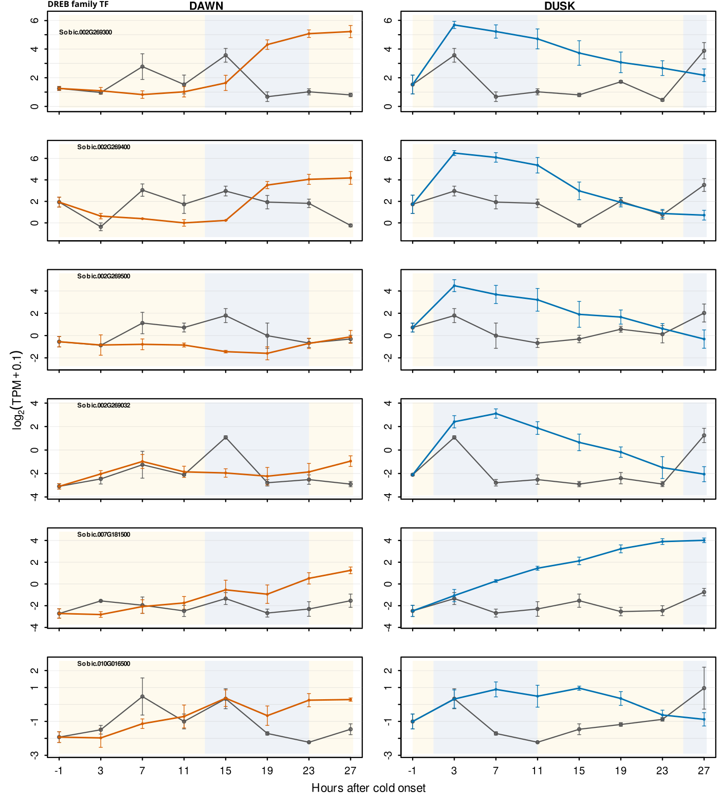

# SFigure_dreb1

**DREB1 (CBF) expression during chilling**

    SFigure_dreb1/
      code/      R code
      data/      inputs (provided/, externalsourcerequired/, generatable/) and data/plotted/
      figure/    the figure (PNG, SVG)

## What it shows

DREB1/CBF genes are almost silent in unstressed leaves, so they fall outside the
diurnal-adjusted analysis and are shown here from raw expression, log2(TPM + 0.1), mean ± SE of
three growth trials. Left: cold begun at dawn (orange); right: cold begun at dusk (blue); gray:
time-matched controls. Shading marks the light (yellow) and dark (blue) periods.

The genes are the sorghum models whose closest Arabidopsis homolog is a DREB subfamily A-1
member and that pass the DESeq2 testing filter:

| Gene | Name |
|---|---|
| Sobic.002G269300 | OsDREB1A |
| Sobic.002G269400 | SbCBF6 |
| Sobic.002G269500 | ZmEREB65 |
| Sobic.002G269032 | DREB1B-like |
| Sobic.007G181500 | DREB/CBF-type |
| Sobic.010G016500 | DREB1C |

## Code

- `code/plot_SFigure_dreb1.R`: computes trajectories, writes the table, draws the figure.

## Plotted data

| File | Contents |
|---|---|
| `data/plotted/SFigure_dreb1_trajectories.csv` | `gene_id, label, onset, hours_after_onset, zt, control_mean, control_se, cold_mean, cold_se` for every plotted point |
| `data/plotted/SFigure_dreb1_trajectories_with_rice_names.csv` | The same table with a `Names` column added by hand (homolog names above) |

## Inputs

| Input | Contents |
|---|---|
| `data/provided/sorghum_cold_timecourse_sample_metadata.csv` | One row per library: sample name, time, treatment (CONT, DAWN, DUSK), replicate, collection time |
| `data/externalsourcerequired/kallisto_tpms.csv.gz` | kallisto TPM, 32,160 genes × 75 libraries |

Check them with `cd data && sha256sum -c SHA256SUMS.txt`.

## Rebuilding

    Rscript SFigure_dreb1/code/plot_SFigure_dreb1.R

Run it from any directory; paths with spaces work. It rewrites `figure/` and `data/plotted/`.
Built with R 4.3.1. Base R graphics only.

## Reproducibility

**Two versions of the figure are in `figure/`:**

- `SFigure_dreb1.png` / `.svg`: exactly what the script makes (6.5 × 7.2 in).
- `SFigure_dreb1_final_handedited.png` / `.svg`: the version in use, edited by hand from the
  script's SVG. It adds a "DREB family TF" heading, labels each panel with the gene ID only, and is
  resized to 4.9 × 5.4 in. These edits are not in the code.

The plotted data are identical in both versions; the script reproduces the trajectory table exactly.
