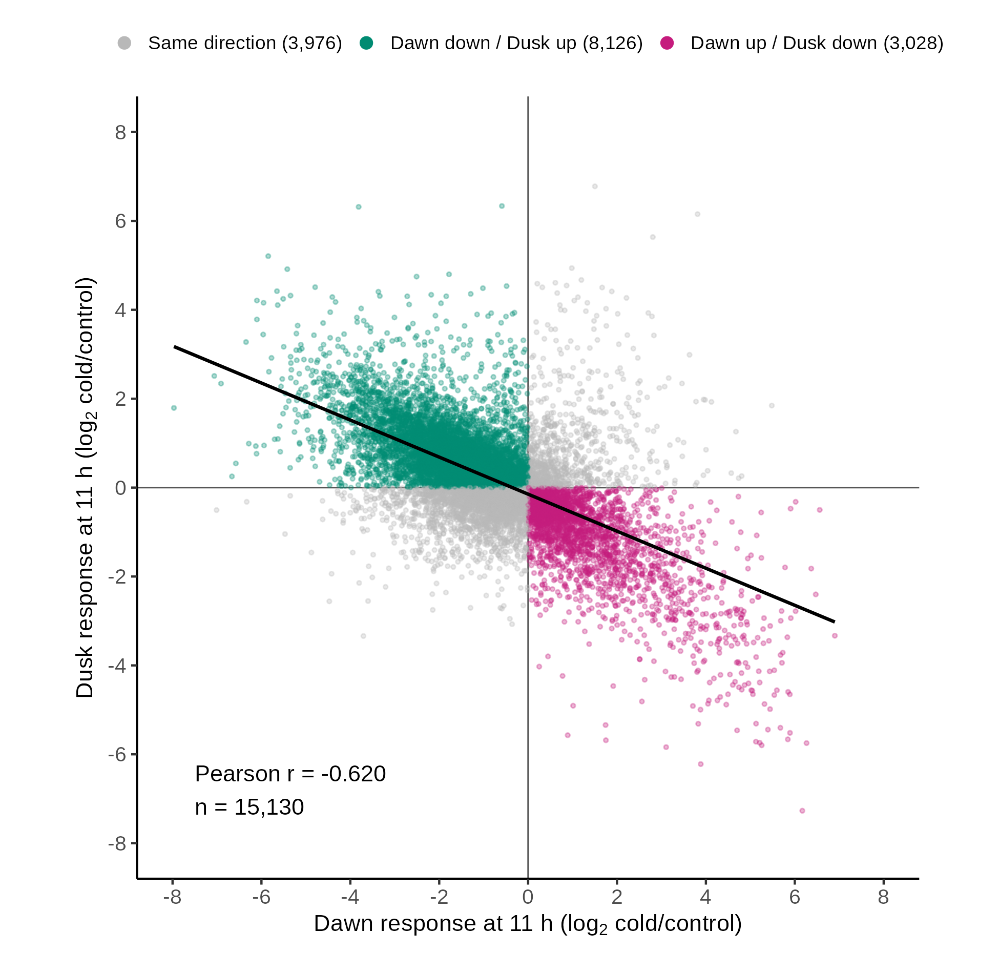

# FigureS_11h_DAWN_DUSK_opposition

**Opposite Dawn and Dusk responses 11 h after cold onset**

    FigureS_11h_DAWN_DUSK_opposition/
      code/      R code
      data/      inputs (provided/, externalsourcerequired/, generatable/) and data/plotted/
      figure/    the figure (PNG, SVG, PDF)

## What it shows

Each point is one of 15,130 genes. The x axis is its response 11 h after dawn cold onset
and the y axis its response 11 h after dusk cold onset, both as log2(cold/control) averaged
over three growth trials. Dusk cold began 12 h later, so the dusk sample is wall-clock T23.
The line is a least-squares fit.

| | |
|---|---|
| Genes | 15,130 |
| Pearson r | −0.620 |
| Same direction (gray) | 3,976 |
| Dawn down / Dusk up (green) | 8,126 |
| Dawn up / Dusk down (magenta) | 3,028 |

## Code

- `code/plot_FigureS_11h_DAWN_DUSK_opposition.R`: computes the responses, writes the tables, draws the figure.
- `code/analysis_universe.R`: shared helper that defines the 15,130-gene universe (mean external TPM ≥ 3 and tested by DESeq2) and the cold-minus-control responses.

## Plotted data

| File | Contents |
|---|---|
| `data/plotted/FigureS_11h_DAWN_DUSK_gene_responses.csv` | `gene_id, dawn_response_log2, dusk_response_log2, direction` for every gene |
| `data/plotted/FigureS_11h_DAWN_DUSK_summary.csv` | n, Pearson r, and genes in each direction group |

Direction groups are named as in the analysis (`DAWN down / DUSK up`); the figure labels them Dawn/Dusk.

## Inputs

| Input | Contents |
|---|---|
| `data/provided/sorghum_cold_timecourse_sample_metadata.csv` | One row per library: sample name, time, treatment (CONT, DAWN, DUSK), replicate, collection time |
| `data/externalsourcerequired/kallisto_tpms.csv.gz` | kallisto TPM, 32,160 genes × 75 libraries |
| `data/generatable/external_diurnal_reference.tsv.gz` | JTK_CYCLE results and eight-phase diurnal waveform of each gene in the independent 24-sample BTx623 series |
| `data/generatable/deseq2_timepoint_contrasts.csv.gz` | DESeq2 results, 22,588 tested genes × 14 cold-vs-control contrasts |

`generatable/` inputs are made by the upstream scripts in `github/Figure2/code/` (DESeq2, external diurnal reference, response categories).
Check them with `cd data && sha256sum -c SHA256SUMS.txt`.

## Rebuilding

    Rscript FigureS_11h_DAWN_DUSK_opposition/code/plot_FigureS_11h_DAWN_DUSK_opposition.R

Run it from any directory; paths with spaces work. It rewrites `figure/` and `data/plotted/`.
Built with R 4.3.1. Needs ggplot2, svglite and systemfonts. Text uses Arial if installed, otherwise Liberation Sans; the PDF is written with `cairo_pdf` so the font is embedded.

## Reproducibility

The script reproduces `figure/FigureS_11h_DAWN_DUSK_opposition.png` pixel for pixel.
