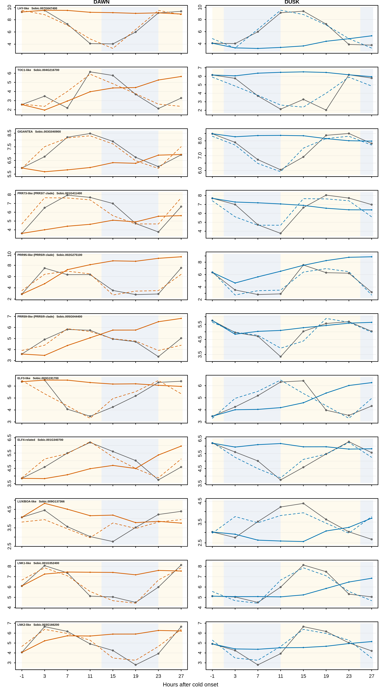

# SFigure_clock_genes

**Core circadian-clock gene trajectories**

    SFigure_clock_genes/
      code/      R code
      data/      inputs (provided/, externalsourcerequired/, generatable/) and data/plotted/
      figure/    the figure (PNG, SVG)

`caption.md` is the figure legend.

## What it shows

Eleven clock and clock-associated genes, one per row, after cold began at dawn (left) or dusk
(right). Gray solid lines are time-matched controls, coloured solid lines are cold-treated leaves,
and coloured dashed lines are the independently measured diurnal waveform mapped to the control
expression scale. Background shading marks the 14-h light (yellow) and 10-h dark (blue) cycle
of the cold experiment. The y axis is log2(TPM + 0.1). Full legend: `caption.md`.

Genes: LHY-like (Sobic.007G047400), TOC1-like (Sobic.004G216700), GIGANTEA (Sobic.003G040900),
PRR73-like (Sobic.001G411400), PRR95-like (Sobic.002G275100), PRR59-like (Sobic.005G044400),
ELF3-like (Sobic.003G191700), ELF4-related (Sobic.001G340700), LUX/BOA-like (Sobic.009G137366),
LNK1-like (Sobic.001G352400), LNK2-like (Sobic.003G166200).

## Code

- `code/plot_SFigure_clock_genes.R`: defines the gene panel, checks the LNK choice, computes trajectories, writes the tables, draws the figure.
- `code/analysis_universe.R`: shared helper (periodic diurnal waveform and sample lookup).

## Plotted data

| File | Contents |
|---|---|
| `data/plotted/SFigure_clock_gene_panel.csv` | The 11 genes: label, external mean TPM, JTK P, period and lag, and the slope/intercept that map the external waveform to the control scale |
| `data/plotted/SFigure_clock_gene_trajectories.csv` | `gene_id, label, onset, hours_after_onset, zt, control_mean, cold_mean, external_prediction` for every plotted point |
| `data/plotted/SFigure_clock_gene_lnk_selection.csv` | The LNK candidates and why two were shown (expression and rhythmicity) |

## Inputs

| Input | Contents |
|---|---|
| `data/provided/sorghum_cold_timecourse_sample_metadata.csv` | One row per library: sample name, time, treatment (CONT, DAWN, DUSK), replicate, collection time |
| `data/externalsourcerequired/kallisto_tpms.csv.gz` | kallisto TPM, 32,160 genes × 75 libraries |
| `data/generatable/external_diurnal_reference.tsv.gz` | JTK_CYCLE results and eight-phase diurnal waveform of each gene in the independent 24-sample BTx623 series |

`generatable/` inputs are made by the upstream scripts in `github/Figure2/code/` (DESeq2, external diurnal reference, response categories).
Check them with `cd data && sha256sum -c SHA256SUMS.txt`.

## Rebuilding

    Rscript SFigure_clock_genes/code/plot_SFigure_clock_genes.R

Run it from any directory; paths with spaces work. It rewrites `figure/` and `data/plotted/`.
Built with R 4.3.1. Base R graphics only.

## Reproducibility

The script reproduces all three plotted-data tables exactly. The PNG it makes shows the same
lines but isn't byte-identical to the original: the original was rendered on a Mac, which shifts
colours slightly (for example orange #C94905 instead of the script's #D55E00).
