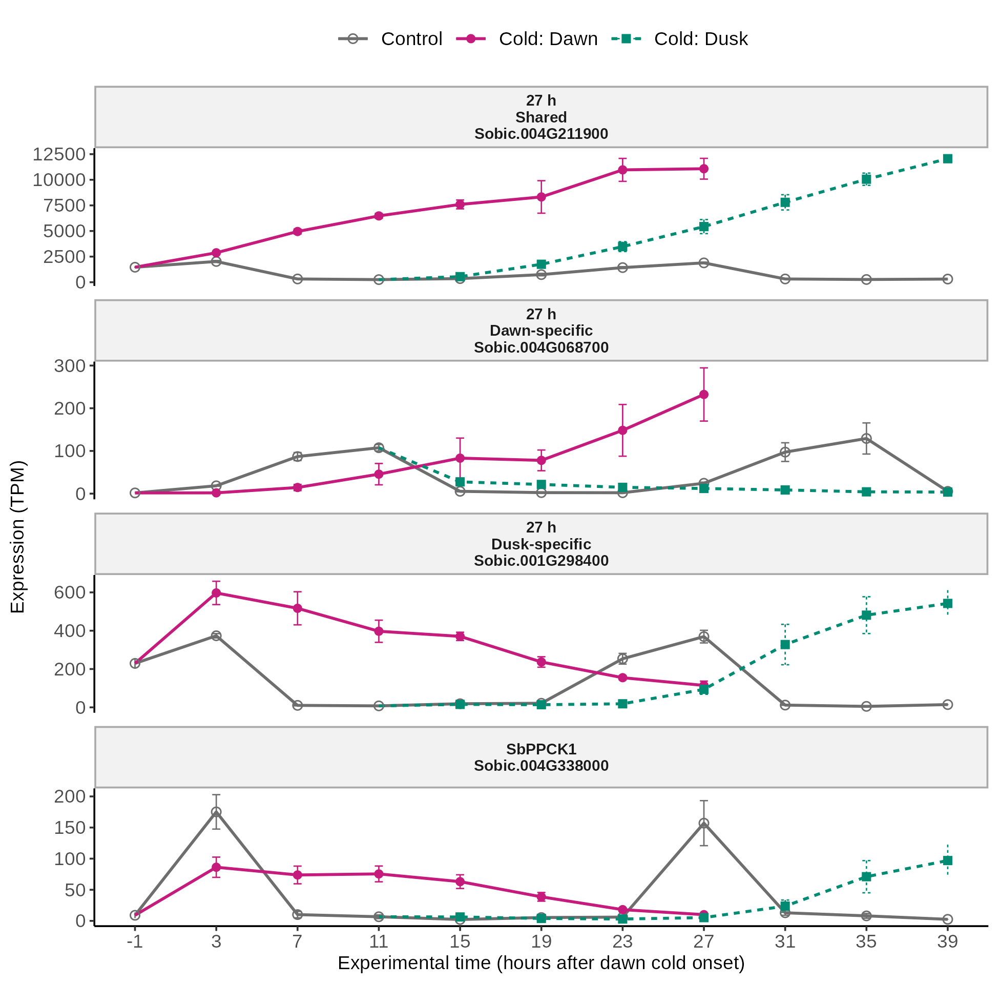

# FigureS_representative_expression

**Expression of representative genes**

    FigureS_representative_expression/
      code/      R code
      data/      inputs (provided/, externalsourcerequired/, generatable/) and data/plotted/
      figure/    the figure (PNG, SVG, PDF)

## What it shows

Expression (TPM; mean ± SE of three growth trials) of the strongest 27-h example from each
induced category, plus SbPPCK1. Control, cold-at-dawn and cold-at-dusk series share one time
axis, in hours after dawn cold onset. Dusk cold began 12 h later, so its 3-h sample is at hour 15.
Each cold line starts from a control point: dawn from the T-1 control, dusk from the T11 control.

| Panel | Gene | Why chosen |
|---|---|---|
| 27 h Shared | Sobic.004G211900 | lowest category q (3.97e-5) |
| 27 h Dawn-specific | Sobic.004G068700 | lowest category q (1.39e-3) |
| 27 h Dusk-specific | Sobic.001G298400 | lowest category q (7.24e-5) |
| SbPPCK1 | Sobic.004G338000 | pre-specified biological example |

Ties in q are broken by the largest absolute Dawn–Dusk difference, then by gene ID.

## Code

- `code/plot_FigureS_representative_expression.R`: picks the genes, summarises TPM, writes the tables, draws the figure.

## Plotted data

| File | Contents |
|---|---|
| `data/plotted/FigureS_representative_expression_genes.csv` | The four genes, category, q value, and why each was chosen |
| `data/plotted/FigureS_representative_expression_summary.csv` | `gene_id, facet, series, experiment_h, mean_tpm, se, n` for every plotted point (n = 3) |

## Inputs

| Input | Contents |
|---|---|
| `data/provided/sorghum_cold_timecourse_sample_metadata.csv` | One row per library: sample name, time, treatment (CONT, DAWN, DUSK), replicate, collection time |
| `data/externalsourcerequired/kallisto_tpms.csv.gz` | kallisto TPM, 32,160 genes × 75 libraries |
| `data/generatable/diurnal_adjusted_response_categories.csv.gz` | Diurnal-adjusted response category and q value of each gene at 3 and 27 h |

`generatable/` inputs are made by the upstream scripts in `github/Figure2/code/` (DESeq2, external diurnal reference, response categories).
Check them with `cd data && sha256sum -c SHA256SUMS.txt`.

## Rebuilding

    Rscript FigureS_representative_expression/code/plot_FigureS_representative_expression.R

Run it from any directory; paths with spaces work. It rewrites `figure/` and `data/plotted/`.
Built with R 4.3.1. Needs ggplot2 and systemfonts. Text uses Arial if installed, otherwise Liberation Sans; the PDF is written with `cairo_pdf`.

## Reproducibility

The script reproduces `figure/FigureS_representative_expression.png` pixel for pixel.
