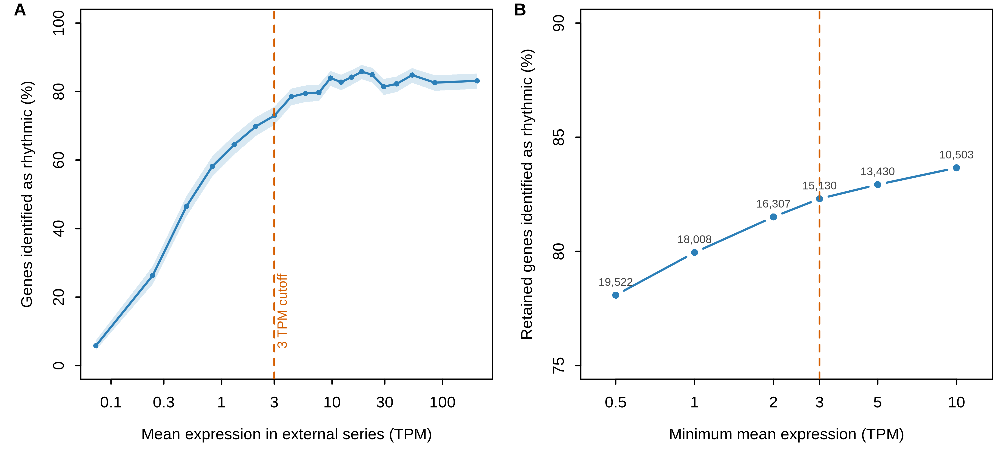

# SFigure_expression_rhythmicity

**Detection of diurnal rhythmicity depends on expression level**

    SFigure_expression_rhythmicity/
      code/      R code
      data/      inputs (provided/, externalsourcerequired/, generatable/) and data/plotted/
      figure/    the figure (PNG, SVG)

`caption.md` is the figure legend.

## What it shows

(A) Percent of DESeq2-tested genes called rhythmic by JTK_CYCLE (adjusted P ≤ 0.01) in 20
equal-count bins of mean TPM in the independent 24-sample BTx623 diurnal series, with 95%
confidence intervals. (B) Rhythmic fraction among genes kept at candidate minimum-expression
thresholds; labels give the number of genes kept. Detection is near its plateau by about 3 TPM
(orange line), the threshold used for the analysis universe in Figure 2. Full legend: `caption.md`.

| Minimum mean TPM | Genes kept | Rhythmic | Fraction |
|---|---|---|---|
| 0.5 | 19,522 | 15,244 | 0.781 |
| 1 | 18,008 | 14,398 | 0.800 |
| 2 | 16,307 | 13,292 | 0.815 |
| **3** | **15,130** | **12,453** | **0.823** |
| 5 | 13,430 | 11,137 | 0.829 |
| 10 | 10,503 | 8,787 | 0.837 |

## Code

- `code/plot_SFigure_expression_rhythmicity.R`: bins genes by expression, computes rhythmic fractions, writes the tables, draws the figure.

## Plotted data

| File | Contents |
|---|---|
| `data/plotted/SFigure_expression_rhythmicity_bins.csv` | Panel A: 20 bins, `genes, median_mean_tpm, rhythmic_fraction, lower_95, upper_95` |
| `data/plotted/SFigure_expression_rhythmicity_thresholds.csv` | Panel B: the table above |

## Inputs

| Input | Contents |
|---|---|
| `data/externalsourcerequired/kallisto_tpms.csv.gz` | kallisto TPM, 32,160 genes × 75 libraries |
| `data/generatable/external_diurnal_reference.tsv.gz` | JTK_CYCLE results and eight-phase diurnal waveform of each gene in the independent 24-sample BTx623 series |
| `data/generatable/deseq2_timepoint_contrasts.csv.gz` | DESeq2 results, 22,588 tested genes × 14 cold-vs-control contrasts |

`generatable/` inputs are made by the upstream scripts in `github/Figure2/code/` (DESeq2, external diurnal reference, response categories).
Check them with `cd data && sha256sum -c SHA256SUMS.txt`.

## Rebuilding

    Rscript SFigure_expression_rhythmicity/code/plot_SFigure_expression_rhythmicity.R

Run it from any directory; paths with spaces work. It rewrites `figure/` and `data/plotted/`.
Built with R 4.3.1. Base R graphics only.

## Reproducibility

The script reproduces both plotted-data tables exactly. The PNG differs from the original only
in rendering (the original was made on a Mac).
